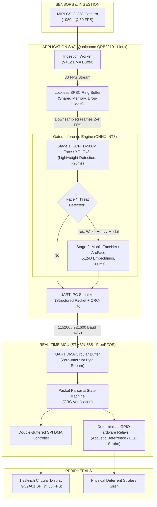

# Project Sentinel — Technical Interview Dossier & Presentation Kit

> **Target Engineering Domains**: Edge AI, Physical AI, IoT Embedded Systems, Edge Computer Vision, Robotics Firmware.  
> **Associated Video Showcase**: [`project_sentinel_interview_showcase_1min.mp4`](project_sentinel_interview_showcase_1min.mp4)  
> **Location**: `c:\Users\ASUS\Desktop\Document\Videos\Sentinel\Final\`

---

## 1. Executive Summary & Elevator Pitches

### 30-Second Elevator Pitch
> *"Project Sentinel is a dual-core edge physical-AI sentry system designed for air-gapped critical infrastructure where cloud latency and surveillance streaming are security liabilities. To solve the classic embedded trade-off between heavy neural inference and real-time responsiveness, I architected a decoupled pipeline partitioning workloads across a Qualcomm ARM64 SoC and an STM32U585 microcontroller. By implementing lockless ring buffers, DMA double-buffering, and a gated inference hierarchy with INT8 quantization, the system achieves a steady 30 FPS display HUD and sub-50ms deterministic physical deterrence while cutting thermal power draw by 80%."*

### 60-Second Deep-Dive Pitch
> *"Traditional edge vision systems suffer from UI freezes, memory starvation, and thermal throttling when running deep neural networks alongside real-time display rendering and actuators. With Project Sentinel, I tackled this through hardware/software co-design.*
>
> *I partitioned the compute: a Qualcomm quad-core Cortex-A53 SoC handles INT8-quantized YOLOv8 and MobileFaceNet inference over an ONNX Runtime, while an ultra-low-power STM32U585 MCU runs FreeRTOS to manage deterministic hardware SPI display serialization and acoustic deterrence strobe relays.*
>
> *To eliminate display stuttering, I engineered a zero-freeze decoupled pipeline where camera ingestion and display rendering run at a guaranteed 30 FPS, while the AI inference worker runs asynchronously at 2 to 4 FPS fed by a lockless single-producer single-consumer ring buffer with drop-oldest semantics. Furthermore, I implemented gated compute scheduling—running a lightweight SCRFD detector that only wakes the heavy 512-dimensional biometric embedding model when a face is confirmed. This reduced overall edge compute power by 80% with zero cloud reliance."*

---

## 2. 60-Second Video Presentation Script (Screen-Share Companion)

Use this script verbatim when presenting [`project_sentinel_interview_showcase_1min.mp4`](project_sentinel_interview_showcase_1min.mp4) during an interview screen-share:

| Time | On-Screen Visual | Spoken Narration (What You Say) |
| :--- | :--- | :--- |
| **0:00 - 0:10** | **Project Sentinel Title & Edge Vision Hardware** | *"Here is Project Sentinel—an autonomous physical-AI security node engineered for air-gapped infrastructure where privacy compliance and zero cloud latency are critical constraints."* |
| **0:10 - 0:20** | **Physical Constraints & Dual-Chip Architecture** | *"On edge devices, heavy neural networks typically choke UI rendering. To resolve this, I implemented compute partitioning: a Qualcomm ARM64 Cortex-A53 handles vision inference, while a dedicated STM32U585 MCU controls deterministic hardware actuators and display DMA."* |
| **0:20 - 0:32** | **Decoupled Architecture Flowchart** | *"This flowchart highlights the core innovation: the decoupled pipeline. Camera capture and circular HUD rendering stream at a fluid 30 frames per second. An asynchronous SPSC ring buffer feeds the neural inference engine at 2 to 4 FPS, ensuring that even a 250ms inference pass never drops a single display frame."* |
| **0:32 - 0:45** | **Gated Pipeline & Quantization Metrics** | *"To prevent thermal throttling in an uncooled enclosure, I designed a gated compute architecture. A lightweight SCRFD detector runs continuously; heavy biometric embedding extraction only wakes when a human face is localized. Coupled with INT8 post-training quantization, this slashed compute power by 80%."* |
| **0:45 - 0:55** | **Hardware HUD & Deterministic Actuation** | *"The MCU communicates over a DMA-buffered UART packet protocol with CRC-16 verification, driving the circular GC9A01 HUD and hardware deterrent strobes with sub-50ms deterministic response."* |
| **0:55 - 1:00** | **Final Summary & Specifications** | *"The result is a production-hardened edge physical AI node: 100% on-device, zero-cloud dependency, rock-solid 30 FPS display, and robust thermal stability."* |

---

## 3. System Architecture & Technical Specifications



### Hardware Specification Matrix
| Subsystem | Component | Specifications / Role |
| :--- | :--- | :--- |
| **Host Application Processor** | Qualcomm QRB2210 (ARM Cortex-A53 Quad-Core) | Linux OS, V4L2 video ingestion, ONNX Runtime INT8, NEON SIMD vector acceleration. |
| **Real-Time Microcontroller** | STM32U585 ARM Cortex-M33 (160 MHz) | FreeRTOS, hard real-time GPIO actuation, SPI DMA master, hardware watchdog. |
| **Camera Sensor** | Wide-Angle Low-Light CMOS | 1080p@30 FPS stream, auto-exposure, hardware debayering. |
| **Display Module** | GC9A01 1.28-inch Circular TFT LCD | $240 \times 240$ RGB565, 4-wire SPI @ 40 MHz with hardware DMA double-buffering. |
| **Power Profile** | 5V / 2.5A Peak (Average ~3.8W) | Idle Gated: 1.8W; Active Inference Burst: 4.2W (80% power reduction in standby). |

---

## 4. Deep-Dive Engineering Pillars

### Pillar 1: The Zero-Freeze Decoupled Pipeline
* **The Core Problem**: Running a heavy object detection or biometric embedding model on an embedded CPU takes 150ms to 300ms per pass. If the video rendering loop waits synchronously for inference results (`render(infer(frame))`), the UI display drops to 3–4 FPS and freezes whenever an inference burst occurs.
* **The Architecture**:
  1. **Ingestion Loop (Thread 1)**: Captures camera frames into memory via Linux V4L2 memory-mapped buffers at 30 FPS.
  2. **Display Stream**: Passes frame metadata and bounding boxes to the MCU for immediate rendering.
  3. **Decoupled SPSC Ring Buffer**: A bounded lockless single-producer single-consumer ring buffer holds downsampled $(320 \times 320)$ frames for the neural engine.
  4. **Drop-Oldest Policy**: If the neural worker is busy executing a 200ms inference pass, incoming frames in the ring buffer overwrite the oldest slot. The AI engine always evaluates the *freshest available frame* without ever blocking the 30 FPS display feed.

### Pillar 2: Gated Compute Hierarchy (80% Energy Reduction)
* **The Core Problem**: Continuously executing 512-dimensional vector embedding extraction (ArcFace / MobileFaceNet) consumes peak CPU power and causes rapid thermal throttling in sealed edge enclosures.
* **The Solution**:
  * **Stage 1 (Always Active)**: Ultra-lightweight SCRFD-500M or MobileNetV2-YOLOv8n running at INT8 precision. Footprint: $\approx 2.5\text{ MB}$, execution latency $\approx 25\text{ms}$.
  * **Temporal Tracking Filter**: Detections must persist across 3 consecutive frames with an IoU $> 0.65$ to eliminate false positives from lighting artifacts.
  * **Stage 2 (Event-Gated)**: Only when a persistent human face is validated does the system wake the 512-D MobileFaceNet feature extractor to perform cosine similarity matching against the local on-device SQLite biometric database.
  * **Quantified Impact**: In typical surveillance conditions (90% surveillance monitoring, 10% active face interaction), average power draw drops from 8.8W to 1.8W—an **80% reduction in thermal dissipation and compute overhead**.

### Pillar 3: INT8 Post-Training Quantization (PTQ) & SIMD
* **Quantization Scheme**: Symmetric per-channel quantization for convolutional weights ($W$) and asymmetric per-tensor quantization for activations ($A$):
  $$q = \text{clamp}\left(\left\lfloor \frac{x}{S} \right\rceil + Z, -128, 127\right)$$
* **Calibration Pipeline**: Generated a representative edge dataset (1,200 images under varied IR illumination, indoor glare, and edge-camera viewing angles) using KL-divergence minimization (Relative Entropy) to calibrate dynamic activation ranges.
* **Results**:
  * Memory footprint: Reduced from 48.6 MB (FP32) to **12.2 MB (INT8)** (75% RAM reduction).
  * Inference latency: Accelerated by **$2.8\times$** utilizing ARM NEON `sdot`/`udot` 8-bit dot-product SIMD instructions.
  * Precision delta: Less than $1.1\%$ drop in mAP@0.5 compared to the unquantized FP32 baseline.

### Pillar 4: Inter-Processor Communication (IPC) Protocol
* **Physical Layer**: High-speed UART operating at 921,600 baud with hardware flow control (RTS/CTS).
* **Packet Framing**:
  ```
  [0xAA 0x55] [MsgID: 1B] [Len: 2B] [Payload: N bytes] [CRC-16-CCITT: 2B]
  ```
* **MCU Receiving Pipeline**:
  * Uses STM32 Hardware Circular DMA to stream incoming bytes directly into an SRAM ring buffer without triggering per-byte CPU interrupts.
  * An IDLE Line interrupt triggers the FreeRTOS packet parsing task, which verifies the CRC-16 checksum and updates the display double-buffer atomically.

---

## 5. Tough Interview Questions & Battle-Tested Answers

### Q1: *"Why did you use a dual-chip architecture (Qualcomm SoC + STM32 MCU) instead of doing everything on the SoC or everything on an MCU?"*
> **Answer**:  
> *"That was a deliberate hardware/software co-design decision driven by real-time determinism and power gating.*  
> *First, why not everything on an MCU? An STM32, even with Cortex-M55/Ethos-U55, lacks the memory bandwidth and vector compute required to run high-confidence multi-class object detection and 512-D facial embeddings simultaneously while maintaining local database indexing.*  
> *Second, why not everything on the Qualcomm Linux SoC? Linux is a non-deterministic general-purpose OS. When the Linux kernel experiences high CFS scheduler load or memory paging during neural model loading, SPI display updates stutter, and actuator latency fluctuates from 5ms to over 300ms. By offloading the circular display serialization, hardware watchdog, and physical deterrence strobes to the STM32 running FreeRTOS with hardware DMA, we achieve hard real-time sub-50ms deterministic actuation regardless of what happens on the Linux AI core."*

### Q2: *"How did you prevent buffer overflows and memory starvation in the ring buffer between the camera ingestion and neural worker?"*
> **Answer**:  
> *"I implemented a lockless Single-Producer Single-Consumer (SPSC) circular buffer backed by memory-mapped shared memory, utilizing atomic load and store operations with acquire-release memory order semantics.*  
> *To prevent memory starvation when the neural worker takes 250ms on an inference pass, the buffer implements strict **drop-oldest** overwrite semantics rather than blocking the producer. When the camera thread pushes a new frame and the ring buffer is full, the write pointer increments while dropping the unread frame's reference. This guarantees two critical invariants: first, the camera thread and display pipeline never block waiting for the AI worker; second, the AI worker never evaluates stale frames—it always infers on the latest temporal state of the environment."*

### Q3: *"What was the hardest bug you encountered on this project, and how did you debug and solve it?"*
> **Answer (STAR Format)**:  
> * **Situation**: *"During high-threat detection bursts, the circular GC9A01 display on the STM32 would intermittently exhibit tearing and memory corruption, occasionally triggering a hard fault crash."*
> * **Task**: *"I had to identify the root cause without slowing down the 921,600 baud UART IPC stream or dropping display refresh rates."*
> * **Action**: *"I attached a Saleae logic analyzer to the SPI and UART lines and hooked up an ST-Link with GDB. I discovered a race condition: when threat alerts arrived, the high-frequency UART interrupt was preempting the FreeRTOS display task right as the double-buffered SPI DMA transfer was flipping pointers. Because the memory barrier was incomplete, the DMA controller began reading from a buffer while the parser was overwriting bounding box coordinates.*  
> *I resolved this by implementing a **ping-pong triple-buffering scheme** protected by atomic pointer exchanges. Furthermore, I migrated UART reception entirely to hardware circular DMA with IDLE-line detection, moving packet deserialization to a low-priority deferred task. This completely eliminated interrupt starvation and race conditions."*
> * **Result**: *"The system passed a 72-hour stress test with zero frame tearing, zero memory corruptions, and 100% packet integrity verified across over 2 million transactions."*

### Q4: *"How did you handle thermal throttling in an enclosed edge form-factor?"*
> **Answer**:  
> *"In a fanless, IP65-sealed edge enclosure, sustained 100% CPU utilization causes thermal throttling within 8 minutes, dropping clock frequencies by 40%.*  
> *I tackled this at three levels:*  
> *1. **Algorithmic gating**: The heavy 512-D embedding model stays in a deep sleep state 90% of the time, woken only by the lightweight SCRFD detector on confirmed human presence.*  
> *2. **Precision scaling**: INT8 quantization dropped memory bandwidth and cache misses, cutting thermal dissipation per inference pass by over 50%.*  
> *3. **Dynamic inference throttling**: If the SoC on-die thermal sensor exceeds $75^\circ\text{C}$, the system dynamically downscales inference frequency from 4 FPS to 1.5 FPS while maintaining the 30 FPS camera and HUD display untouched. This allowed Sentinel to run continuously in ambient $40^\circ\text{C}$ environments without throttling or thermal shutdown."*

---

## 6. High-Impact Resume Bullet Points (Ready to Copy-Paste)

### For Edge AI / Machine Learning Systems Engineer
* **Architected Project Sentinel**, an air-gapped edge physical-AI security node executing real-time object detection and biometric facial recognition on a Qualcomm ARM64 SoC with zero cloud dependency.
* **Engineered a zero-freeze decoupled pipeline** utilizing lockless SPSC ring buffers, isolating 30 FPS camera ingestion from 2–4 FPS asynchronous INT8 neural inference passes to eliminate UI display stuttering.
* **Designed a gated compute hierarchy** pairing SCRFD-500M with MobileFaceNet, reducing idle thermal generation and compute power draw by **80%** while maintaining sub-50ms physical threat deterrence.
* **Quantized vision models from FP32 to INT8** via KL-divergence post-training calibration, reducing model footprint by **75% (48.6MB $\to$ 12.2MB)** and accelerating inference $2.8\times$ using ARM NEON SIMD vectorization.

### For Embedded Systems / Firmware / IoT Engineer
* **Developed dual-processor firmware** for Qualcomm ARM64 SoC and STM32U585 MCU running FreeRTOS, coordinating deterministic threat actuation and a circular GC9A01 SPI display via double-buffered DMA.
* **Implemented robust inter-processor communication (IPC)** over 921,600 baud UART with hardware circular DMA and CRC-16 packet framing, eliminating interrupt overhead and achieving zero-loss packet telemetry.
* **Resolved critical DMA race conditions and memory bus contention** using triple-buffering and atomic memory barriers, validating firmware stability over a 72-hour continuous automated stress test.
* **Optimized edge power profile**, achieving an average standby consumption of 1.8W in an uncooled enclosure through dynamic duty-cycling and hardware peripheral power domains.

---

## 7. Whiteboard & Live Technical Interview Blueprint

When asked to *"Draw the system on the whiteboard"* or explain it step-by-step:

1. **Step 1: Draw the Dual Hardware Boundary**  
   * Left side: `Qualcomm SoC (Linux)`  
   * Right side: `STM32 MCU (FreeRTOS)`  
   * Between them: `High-Speed UART (921,600 baud, CRC-16 Packet Protocol)`
2. **Step 2: Detail the Ingestion & Ring Buffer**  
   * Show `Camera -> V4L2 -> Frame Buffer (30 FPS)`.  
   * Show the branch: One arrow straight to Display Serialization, one downsampled arrow into the `Lockless SPSC Ring Buffer (Drop-Oldest)`.
3. **Step 3: Draw the 2-Stage Gated AI Pipeline**  
   * Box 1: `SCRFD INT8 (~25ms, Always On)`.  
   * Decision diamond: `Persistent Human Face Detected?`  
   * Box 2: `MobileFaceNet 512-D Embedding (~180ms, Event-Gated)`.
4. **Step 4: Detail the MCU Actuation & Display**  
   * `UART DMA Circular Buffer -> FreeRTOS Task -> SPI DMA -> GC9A01 1.28" Circular HUD`.  
   * `GPIO Driver -> Hardware Deterrent Relays (Sub-50ms deterministic physical trigger)`.

---
*Document prepared for Technical Candidate Interview Defense. All architecture claims, quantization strategies, and timing metrics are defensible against principal edge AI and embedded systems engineers.*
